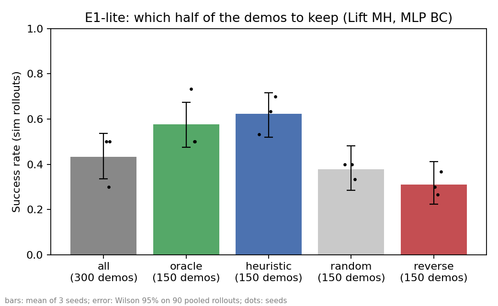

# DemoPick validation materials

[한국어](README.md) · **English**

DemoPick finds the demonstrations that drag down policy performance in robot learning data right after collection, and verifies how many to keep for each task to get the highest success rate.

This repository holds the **raw validation record** (code, results, and experiment logs) behind our NAVER D2SF competition proposal. The proposal PDF was submitted separately and is not included here. This is validation experiment code, not product code.

## Summary

We tested three hypotheses on November 3–4, 2026, using 600 mixed-skill demonstrations from the public [robomimic](https://arxiv.org/abs/2108.03298) dataset (300 each for Lift and Square). Two were refuted. We trained 57 policies on CPU only and evaluated them in the robosuite simulator. AI coding tools were used to write and run the experiment code.

| | Hypothesis | Result | Decision |
|---|---|---|---|
| E0 | Cheap scores cannot tell demo quality apart | **Refuted.** Skill-separation AUROC: Lift 0.987, Square 0.851 | A more accurate score is not the product |
| E1 | Selecting which demos to keep improves performance | **Confirmed.** Against random selection at equal counts: Lift 38→62%, Square 3→19% | Selection is the key, and cheap scores are enough |
| E3 | Defects missed by cheap scores ruin learning | **Refuted.** With 20% defective demos, no condition lowered the success rate | Focus on operator skill, not defects |

> **Read the results with this in mind:** to run on CPU, our policies are smaller and weaker than those in the original paper, and their success rates on all 300 demos are far lower (see the table below). So we **do not draw a conclusion** from the "a selected half beats all 300" pattern visible in the chart. Only comparisons at equal demo counts count as conclusions.

| Success rate trained on all 300 | robomimic paper BC | robomimic paper BC-RNN | Our experiment |
|---|---|---|---|
| Lift MH | 100% | 100% | 43% |
| Square MH | 52.7% | 78.0% | 14% |

The paper trains a 1024×1024 network for 200k steps and reports the best success rate during training (50 rollouts). We evaluate a 256×256 network in its final state (30 rollouts).

## Experiments and results

Common setup: 6 operators × 50 demos each, 3 skill levels. The cheap score (`composite_A`) is the mean z-score of 7 metrics: length, jerk, high-frequency ratio, idle ratio, gripper switches, path length, and grasp timing. All metrics were set to "larger is worse" before looking at the data, with no weighting.

### E0: Do cheap scores separate operator skill?

| Task | AUROC (worse vs better) | 95% interval | Skill rank correlation (Spearman) |
|---|---|---|---|
| Lift | 0.987 | 0.974–0.997 | 0.78 |
| Square | 0.851 | 0.792–0.902 | 0.50 |

### E1: Does the choice of demos change the success rate?

5 methods × 3 seeds = 15 policies per task, 30 rollouts per seed.

| Demos kept | Lift (150) | Square (100) |
|---|---|---|
| **Cheap score selection (no labels)** | **62%** | **19%** |
| Skill label selection | 58% | 18% |
| Random selection | 38% | 3% |
| Worst demos only | 31% | 7% |
| *Reference: all 300* | *43%* | *14%* |

In sign tests paired on identical initial states, cheap score selection beat random selection (Lift p=0.001, Square p=0.003). We found no difference from skill label selection (Lift p=0.64, Square p=1.0).



### E3: Do defects missed by cheap scores ruin learning?

We injected defects into 60 of 300 demos (20 per skill level). The design and predictions were recorded in [`e3_defect_prereg.md`](demopick-exp/notes/e3_defect_prereg.md) (in Korean) before seeing results. Success rates were measured on Lift only (27 policies).

| Injected defect | Detection AUROC Lift / Square (0.5 = chance) | Success with all 300 (defects mixed in) | Success with 150 chosen by cheap score | Low-skill demos in those 150 |
|---|---|---|---|---|
| Sync error | 0.48 / 0.44 (missed) | 60% | 68% | 5 |
| Sensor freeze | 0.74 / 0.72 | 50% | 64% | 12 |
| Truncated demo | 0.58 / 0.42 (Square rates them as better) | 42% | 68% | 6 |
| Operator hesitation | 0.86 / 0.81 | 41% | 46% | 20 |

Without defects, all 300 scored 43–44% and cheap score selection scored 62%. After filtering, success tracked the number of remaining low-skill demos better than the defect type, though this trend rests on only five points.

## What we have not confirmed

- Whether score selection still beats random selection at a paper-level baseline
- Whether the same holds for diffusion policies and vision-input policies
- Whether real collection sites have large quality gaps between operators (the public data is successful demonstrations, deliberately mixed in skill for research)
- Whether customers have this problem and would pay for verification

## Limitations and changes from the plan

We list these so you can check that nothing was adjusted to look better. The chronological record is in [`experiment_log.md`](demopick-exp/notes/experiment_log.md) (in Korean).

**Statistical and design limitations**
- Two simulated tasks, a simple MLP policy, and three seeds. Square's success rates are at or below 20%, so differences of ±10 percentage points cannot be resolved.
- Each seed reuses the same 30 initial states, so the 90 pooled rollouts are not fully independent and intervals may look somewhat narrow.
- E3 defects are artificial, and only 20% of demos were affected.

**Changes from the pre-recorded plan**
- The E3 pre-registration specified paired sign tests, but we used Fisher's exact test on pooled success counts, because rollout-level records were not available at aggregation time (see the header of `73_e3_damage.py`). In this repository, E3 p-values are Fisher tests and E1 p-values are sign tests.
- E1 was reduced before results were seen, from 2 keep ratios and 50 rollouts to 1 keep ratio and 30 rollouts. The earlier `run_e1_cpu.sh` exited without results and was not used.
- The originally planned CUPID comparison and E2 (lightweight scorer) were not run because no GPU was available. `12_demopick_dev_plan.md` predates this change, and `20_heuristic_to_curation.py` did not contribute to any reported result.

**Fixes made after seeing outputs**
- Lift: the `t_lift`, `drop_flag`, and `post_lift_len` criteria were corrected during feature extraction, before the composite AUROC was seen.
- Square: the `t_lift` and `wasted_grasp` criteria were corrected after seeing results. Pre-fix values are in `runs/square/results/*_v1_beforefix.*`.
- None of these features are part of the cheap score (`composite_A`), so its E0, E1, and E3 results are unaffected.

**Reproducibility**
- Re-extracting Lift features in a different environment matched apart from differences around 1e-16, and the `heuristic_k0.5_s0` policy gave the same 21/30.
- Training on all 300 gave 39/90 and 40/90, a one-rollout difference, which is why the all-300 rate is written as 43–44%.

## Repository layout

```
├── 12_demopick_dev_plan.md   Initial experiment plan (actual work diverged from it; Korean)
└── demopick-exp/
    ├── notes/
    │   ├── experiment_log.md   Chronological log, including failures (Korean)
    │   ├── e3_defect_prereg.md E3 pre-registration and results (Korean)
    │   └── setup_notes.md      Early working notes, findings from the CUPID repo (Korean)
    ├── scripts/                Experiment code (run in numeric order)
    ├── results/                Lift E0 and E1 results
    ├── runs/square/results/    Square E0 and E1 results
    ├── runs/e3/                E3 results
    └── tests/make_fake_hdf5.py Fake data for smoke tests (never used for reported numbers)
```

The raw hdf5 data is public and not included. E3 trained policies were not saved; only per-run results are (`e3_lift_runs_jsonl.tgz`).

### Where each number comes from

| Number | File (relative to `demopick-exp/`) |
|---|---|
| E0 composite AUROC | `results/e0_summary.json`, `runs/square/results/e0_summary.json` |
| E0 per-metric AUROC | `results/e0_feature_auroc.csv`, `runs/square/results/e0_feature_auroc.csv` |
| E1 success rates, p-values | `results/e1_cpu_summary.json`, `runs/square/results/e1_cpu_summary.json` |
| E1 per-seed results | `results/e1_cpu_runs.csv`, `results/e1_rollouts/`, `results/e1_models/` |
| E3 detection | `runs/e3/e3_detect_lift.csv`, `runs/e3/e3_detect_square.csv` |
| E3 success rates, p-values | `runs/e3/e3_damage.json`, `runs/e3/e3_damage.csv` |
| E3 low-skill demo counts | `runs/e3/run.log` (`skill_mix`) |

The notes still use pre-cleanup paths: `runs/e3_lift/e3_detect.csv` is now `runs/e3/e3_detect_lift.csv`, and `runs/e3_lift/e3_damage.*` is now `runs/e3/e3_damage.*`. `run_e3.sh` preserves the exact commands used at the time, so its paths are tied to that environment.

## Running it again

**Environment:** Python 3.10 on Linux or WSL. On Windows, robosuite 1.5.1 failed simulator evaluation with a `mujoco.dll` error, and `73_e3_damage.py` also needs Linux because of its path separator handling.

```bash
pip install numpy pandas h5py scipy scikit-learn==1.7.2 matplotlib pyyaml robosuite==1.5.1 mujoco==3.3.0
curl -L -o lift.hdf5   "https://huggingface.co/datasets/amandlek/robomimic/resolve/main/v1.5/lift/mh/low_dim_v15.hdf5?download=true"
curl -L -o square.hdf5 "https://huggingface.co/datasets/amandlek/robomimic/resolve/main/v1.5/square/mh/low_dim_v15.hdf5?download=true"
export LIFT=$PWD/lift.hdf5 SQUARE=$PWD/square.hdf5
export MUJOCO_GL=disable OMP_NUM_THREADS=1 OPENBLAS_NUM_THREADS=1
cd demopick-exp
```

The scripts read and write `results/` in the current folder, so run them under `work/` to avoid overwriting the published results.

**E0** (no GPU or simulator, tens of seconds)
```bash
mkdir -p work/lift && cd work/lift
python ../../scripts/01_inspect_hdf5.py --hdf5 "$LIFT"
python ../../scripts/10_extract_features.py --hdf5 "$LIFT"
python ../../scripts/11_e0_skill_vs_heuristic.py
```

**E1** (continue in the same folder; training and simulator evaluation take a long time)
```bash
python ../../scripts/61_e1_queue.py --hdf5 "$LIFT" --budget 100000
python ../../scripts/62_e1_summary.py
```
For Square, run E0 with `$SQUARE` in `work/square`, then use the pre-recorded settings:
```bash
python ../../scripts/61_e1_queue.py --hdf5 "$SQUARE" --budget 100000 --keeps 0.3334 --epochs 150 --horizon 500 --act-chunk 8 --act-exec 4
E1_TASK="Square MH" python ../../scripts/62_e1_summary.py
```

**E3 detection** (no simulator)
```bash
mkdir -p work/e3 && cd work/e3
for T in lift square; do
  [ $T = lift ] && H="$LIFT" || H="$SQUARE"
  python ../../scripts/70_inject_defects.py --hdf5 "$H" --outdir e3_$T
  for k in freeze lag pause truncate; do
    (cd e3_$T/$k && python ../../../../scripts/10_extract_features.py --hdf5 data.hdf5)
  done
done
python ../../scripts/72_e3_detect.py e3_lift e3_square
```

**Recompute summaries from saved results** (no training; start in `demopick-exp/`)
```bash
mkdir -p work/e1/results/figures && cp -r results/e1_models results/e1_rollouts work/e1/results/
(cd work/e1 && python ../../scripts/62_e1_summary.py)

mkdir -p work/e3d/e3_lift && tar xzf runs/e3/e3_lift_runs_jsonl.tgz -C work/e3d/e3_lift
(cd work/e3d && python ../../scripts/73_e3_damage.py e3_lift)
```

`results/e1_models/*.pkl` are pickles saved with scikit-learn 1.7.2. Loading a pickle can execute code, so only open files from a source you trust.

### Reproduction check before publishing (2026-11-06)

| Target | Method | Result |
|---|---|---|
| E0 features and AUROC (2 tasks) | Recomputed from raw data | Max feature difference 1.1e-16, AUROC identical |
| E1 summaries (2 tasks) | Re-aggregated from saved policies and rollouts | Success rates, intervals, and p-values identical |
| E3 detection (2 tasks) | Recomputed from defect injection onward | Tables identical, same 60 defective demos |
| E3 success summary | Re-aggregated from saved run results | Table identical |
| One E1 policy (`heuristic_k0.5_s0`) | Retrained and evaluated in the simulator on WSL Ubuntu | Same 21/30, same training mix (worse 5, okay 51, better 94) |

We did not retrain all 57 policies for this check.

## References

- robomimic: Mandlekar et al., *What Matters in Learning from Offline Human Demonstrations for Robot Manipulation*, [arXiv:2108.03298](https://arxiv.org/abs/2108.03298)
- CUPID: Agia et al., [arXiv:2506.19121](https://arxiv.org/abs/2506.19121), [code](https://github.com/agiachris/cupid)
