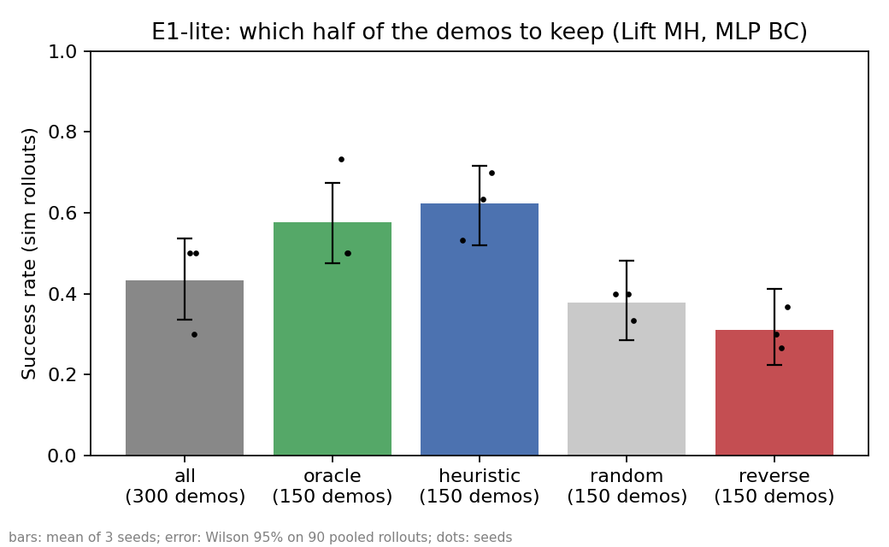

# 데모픽(DemoPick) 검증 자료

**한국어** · [English](README.en.md)

데모픽은 로봇 학습 데이터에서 정책 성능을 끌어내리는 시연을 수집 직후 찾아내고, 과제마다 어디까지 남겨야 성공률이 가장 높은지 검증하는 도구입니다.

이 저장소는 네이버 D2SF 공모전 기획서의 **검증 과정 원본**(코드, 결과, 실험 기록)을 담습니다. 기획서 PDF는 별도로 제출했으며 여기에는 없습니다. 제품 코드가 아니라 검증 실험 코드입니다.

## 요약

공개 데이터 [robomimic](https://arxiv.org/abs/2108.03298)의 혼합 숙련도 시연 600개(Lift, Square 각 300개)로 2026년 11월 3~4일에 가설 3개를 시험했습니다. 두 개는 반박됐습니다. CPU만으로 정책 57개를 학습해 robosuite 시뮬레이터에서 평가했고, 실험 코드 작성과 실행에는 AI 코딩 도구를 썼습니다.

| | 가설 | 결과 | 그래서 정한 것 |
|---|---|---|---|
| E0 | 값싼 점수는 품질을 못 가린다 | **반박.** 숙련도 구분 AUROC Lift 0.987, Square 0.851 | 더 정확한 점수는 제품이 아니다 |
| E1 | 남길 시연을 고르면 성능이 오른다 | **확인.** 같은 개수에서 무작위 대비 Lift 38→62%, Square 3→19% | 선별이 핵심이고, 값싼 점수로 된다 |
| E3 | 값싼 점수가 놓친 결함이 학습을 망친다 | **반박.** 결함 20%를 섞어도 성공률이 떨어진 조건 없음 | 결함이 아니라 숙련도에 집중한다 |

> **결과를 읽을 때 주의할 점:** 저희 정책은 CPU로 돌리기 위해 원논문보다 작고 약합니다. 300개 전체 학습 성공률이 원논문보다 크게 낮습니다(아래 표). 그래서 그래프에 보이는 "전체 300개보다 선별한 절반이 낫다"는 **결론으로 쓰지 않고**, 같은 개수끼리의 비교만 결론으로 씁니다.

| 300개 전체로 학습한 성공률 | robomimic 원논문 BC | robomimic 원논문 BC-RNN | 저희 실험 |
|---|---|---|---|
| Lift MH | 100% | 100% | 43% |
| Square MH | 52.7% | 78.0% | 14% |

원논문은 1024×1024 신경망을 20만 스텝 학습하고 학습 중 최고 성공률(롤아웃 50회)을 보고했고, 저희는 256×256 신경망을 마지막 상태 그대로(롤아웃 30회) 평가했습니다.

## 실험과 결과

공통 조건: 작업자 6명 × 시연 50개, 숙련도 3등급. 값싼 점수(`composite_A`)는 길이, 흔들림, 고주파 비율, 정체 비율, 그리퍼 전환, 경로 길이, 파지 시점 7개 지표의 z-점수 평균입니다. 모든 지표는 데이터를 보기 전에 "클수록 나쁨"으로 정했고 가중치는 없습니다.

### E0: 값싼 점수가 숙련도를 가려내는가

| 과제 | AUROC (worse vs better) | 95% 구간 | 숙련도 순위 상관(스피어만) |
|---|---|---|---|
| Lift | 0.987 | 0.974~0.997 | 0.78 |
| Square | 0.851 | 0.792~0.902 | 0.50 |

### E1: 어떤 시연을 남기느냐가 성공률을 바꾸는가

과제당 5개 방법 × 시드 3개 = 정책 15개. 시드당 롤아웃 30회.

| 남긴 시연 | Lift (150개) | Square (100개) |
|---|---|---|
| **값싼 점수 선별 (라벨 없음)** | **62%** | **19%** |
| 숙련도 라벨 선별 | 58% | 18% |
| 무작위 선별 | 38% | 3% |
| 나쁜 것만 남김 | 31% | 7% |
| *참고: 전체 300개* | *43%* | *14%* |

같은 초기 상태끼리 짝지은 부호 검정 결과, 값싼 점수 선별은 무작위보다 성공률이 높았습니다(Lift p=0.001, Square p=0.003). 숙련도 라벨 선별과는 차이를 찾지 못했습니다(Lift p=0.64, Square p=1.0).



### E3: 값싼 점수가 놓친 결함이 학습을 망치는가

시연 300개 중 60개(숙련도별 20개)에 결함을 넣었습니다. 설계와 예상은 결과를 보기 전에 [`e3_defect_prereg.md`](demopick-exp/notes/e3_defect_prereg.md)에 기록했습니다. 성공률은 Lift에서만 쟀습니다(정책 27개).

| 넣은 결함 | 탐지력 AUROC Lift / Square (0.5 = 우연) | 결함 섞인 300개 성공률 | 값싼 점수로 고른 150개 성공률 | 그 150개 속 숙련도 낮은 시연 |
|---|---|---|---|---|
| 동기화 오류 | 0.48 / 0.44 (못 잡음) | 60% | 68% | 5개 |
| 센서 끊김 | 0.74 / 0.72 | 50% | 64% | 12개 |
| 중단된 시연 | 0.58 / 0.42 (Square는 오히려 좋게 봄) | 42% | 68% | 6개 |
| 작업자 머뭇거림 | 0.86 / 0.81 | 41% | 46% | 20개 |

결함이 없을 때는 전체 43~44%, 값싼 점수 선별 62%였습니다. 걸러 낸 뒤의 성공률은 결함 종류보다 남은 숙련도 낮은 시연 수와 더 잘 맞았지만, 점 5개로 본 경향입니다.

## 아직 확인하지 못한 것

- 원논문 수준 기준선에서도 점수 선별이 무작위보다 나은가
- 확산 정책, 영상 입력 정책에서도 같은가
- 실제 수집 현장에도 작업자 간 품질 차이가 크게 있는가 (사용한 공개 데이터는 연구용으로 숙련도를 섞어 만든 성공 시연입니다)
- 고객이 이 문제를 겪고 있고 검증에 비용을 쓸 의향이 있는가

## 한계와 계획에서 달라진 점

좋게 보이도록 고치지 않았는지 확인하실 수 있게 그대로 적습니다. 시간순 원본은 [`experiment_log.md`](demopick-exp/notes/experiment_log.md)에 있습니다.

**통계와 설계의 한계**
- 시뮬레이션 2과제, 단순 MLP 정책, 시드 3개입니다. Square는 성공률이 20% 이하라 ±10%p 차이를 가리지 못합니다.
- 시드마다 같은 초기 상태 30개를 다시 쓰므로, 합산 90회는 완전히 독립이 아닙니다. 구간이 다소 좁게 보일 수 있습니다.
- E3의 결함은 인공으로 만들었고 20%만 섞었습니다.

**사전 계획에서 달라진 점**
- E3 사전 기록은 짝지은 부호 검정을 쓰기로 했지만, 실제로는 합산 성공 수의 Fisher 정확 검정을 썼습니다. 집계 시점에 롤아웃 단위 기록이 없었기 때문입니다(`73_e3_damage.py` 상단 주석). 이 저장소의 p값 중 E3 값은 Fisher 검정, E1 값은 부호 검정입니다.
- E1은 결과를 보기 전에 규모를 줄였습니다. 남기는 비율 2개·롤아웃 50회에서 비율 1개·롤아웃 30회로 바꿨습니다. 이전 설정의 `run_e1_cpu.sh`는 결과 없이 종료되어 쓰지 않았습니다.
- 처음 계획한 CUPID 비교와 E2(경량 채점기)는 GPU가 없어 실행하지 않았습니다. `12_demopick_dev_plan.md`는 이 변경 전의 계획이고, `20_heuristic_to_curation.py`는 보고한 결과에 쓰이지 않았습니다.

**결과를 본 뒤 고친 것**
- Lift의 `t_lift`, `drop_flag`, `post_lift_len` 판정 기준을 고쳤습니다. 합성 AUROC를 보기 전, 특징 추출 단계에서 고쳤습니다.
- Square의 `t_lift`, `wasted_grasp` 판정 기준을 결과를 본 뒤 고쳤습니다. 수정 전 값은 `runs/square/results/*_v1_beforefix.*`에 있습니다.
- 위 수정은 모두 값싼 점수(`composite_A`)에 쓰이지 않는 특징이라 E0·E1·E3의 값싼 점수 결과에는 영향이 없습니다.

**재현성**
- 다른 환경에서 Lift 특징을 다시 뽑으면 1e-16 수준 차이를 빼고 같았고, `heuristic_k0.5_s0` 정책은 같은 21/30이 나왔습니다.
- 300개 전체 학습은 39/90과 40/90으로 롤아웃 1회 차이가 있었습니다. 그래서 전체 300개 성공률을 43~44%로 적었습니다.

## 저장소 구조

```
├── 12_demopick_dev_plan.md   초기 실험 계획 (이후 실제 진행과 달라짐)
└── demopick-exp/
    ├── notes/
    │   ├── experiment_log.md   시간순 실험 기록 (실패 포함)
    │   ├── e3_defect_prereg.md E3 사전 고정과 결과
    │   └── setup_notes.md      초기 작업 메모, CUPID 저장소 확인 사항
    ├── scripts/                실험 코드 (번호순 실행)
    ├── results/                Lift E0·E1 결과
    ├── runs/square/results/    Square E0·E1 결과
    ├── runs/e3/                E3 결과
    └── tests/make_fake_hdf5.py 동작 확인용 가짜 데이터 (수치 보고에 쓰지 않음)
```

원본 데이터(hdf5)는 공개 데이터라 저장소에 넣지 않았습니다. E3 학습 정책은 저장하지 않았고 실행별 결과(`e3_lift_runs_jsonl.tgz`)만 있습니다.

### 수치별 원본 파일

| 수치 | 파일 (`demopick-exp/` 기준) |
|---|---|
| E0 합성 AUROC | `results/e0_summary.json`, `runs/square/results/e0_summary.json` |
| E0 지표별 AUROC | `results/e0_feature_auroc.csv`, `runs/square/results/e0_feature_auroc.csv` |
| E1 성공률, p값 | `results/e1_cpu_summary.json`, `runs/square/results/e1_cpu_summary.json` |
| E1 시드별 결과 | `results/e1_cpu_runs.csv`, `results/e1_rollouts/`, `results/e1_models/` |
| E3 탐지력 | `runs/e3/e3_detect_lift.csv`, `runs/e3/e3_detect_square.csv` |
| E3 성공률, p값 | `runs/e3/e3_damage.json`, `runs/e3/e3_damage.csv` |
| E3 숙련도 낮은 시연 수 | `runs/e3/run.log` (`skill_mix`) |

기록 문서에는 정리 전 경로가 남아 있습니다. `runs/e3_lift/e3_detect.csv`는 `runs/e3/e3_detect_lift.csv`이고, `runs/e3_lift/e3_damage.*`는 `runs/e3/e3_damage.*`입니다. `run_e3.sh`는 실행 당시 명령을 그대로 보존한 파일이라 경로가 실행 환경에 고정되어 있습니다.

## 다시 돌려 보기

**환경:** Python 3.10, Linux 또는 WSL. Windows에서는 robosuite 1.5.1이 `mujoco.dll` 오류로 시뮬레이터 평가가 되지 않았고, `73_e3_damage.py`도 경로 구분자 때문에 Linux에서 실행해야 합니다.

```bash
pip install numpy pandas h5py scipy scikit-learn==1.7.2 matplotlib pyyaml robosuite==1.5.1 mujoco==3.3.0
curl -L -o lift.hdf5   "https://huggingface.co/datasets/amandlek/robomimic/resolve/main/v1.5/lift/mh/low_dim_v15.hdf5?download=true"
curl -L -o square.hdf5 "https://huggingface.co/datasets/amandlek/robomimic/resolve/main/v1.5/square/mh/low_dim_v15.hdf5?download=true"
export LIFT=$PWD/lift.hdf5 SQUARE=$PWD/square.hdf5
export MUJOCO_GL=disable OMP_NUM_THREADS=1 OPENBLAS_NUM_THREADS=1
cd demopick-exp
```

스크립트는 현재 폴더의 `results/`에 읽고 쓰므로, 공개된 결과를 덮어쓰지 않도록 `work/` 아래에서 실행합니다.

**E0** (GPU·시뮬레이터 불필요, 수십 초)
```bash
mkdir -p work/lift && cd work/lift
python ../../scripts/01_inspect_hdf5.py --hdf5 "$LIFT"
python ../../scripts/10_extract_features.py --hdf5 "$LIFT"
python ../../scripts/11_e0_skill_vs_heuristic.py
```

**E1** (위 폴더에서 이어서. 학습과 시뮬레이터 평가로 오래 걸림)
```bash
python ../../scripts/61_e1_queue.py --hdf5 "$LIFT" --budget 100000
python ../../scripts/62_e1_summary.py
```
Square는 `work/square`에서 `$SQUARE`로 E0를 실행한 뒤, 사전 고정 설정으로 돌립니다.
```bash
python ../../scripts/61_e1_queue.py --hdf5 "$SQUARE" --budget 100000 --keeps 0.3334 --epochs 150 --horizon 500 --act-chunk 8 --act-exec 4
E1_TASK="Square MH" python ../../scripts/62_e1_summary.py
```

**E3 탐지** (시뮬레이터 불필요)
```bash
mkdir -p work/e3 && cd work/e3
for T in lift square; do
  [ $T = lift ] && H="$LIFT" || H="$SQUARE"
  python ../../scripts/70_inject_defects.py --hdf5 "$H" --outdir e3_$T
  for k in freeze lag pause truncate; do
    (cd e3_$T/$k && python ../../../../scripts/10_extract_features.py --hdf5 data.hdf5)
  done
done
python ../../scripts/72_e3_detect.py e3_lift e3_square
```

**저장된 결과에서 집계만 다시 내기** (학습 없음, `demopick-exp/`에서 시작)
```bash
mkdir -p work/e1/results/figures && cp -r results/e1_models results/e1_rollouts work/e1/results/
(cd work/e1 && python ../../scripts/62_e1_summary.py)

mkdir -p work/e3d/e3_lift && tar xzf runs/e3/e3_lift_runs_jsonl.tgz -C work/e3d/e3_lift
(cd work/e3d && python ../../scripts/73_e3_damage.py e3_lift)
```

`results/e1_models/*.pkl`은 scikit-learn 1.7.2로 저장한 pickle입니다. pickle은 불러올 때 코드를 실행할 수 있으니 신뢰할 수 있는 경로에서 받은 파일만 여세요.

### 공개 전 재현 확인 (2026-11-06)

| 대상 | 방법 | 결과 |
|---|---|---|
| E0 특징·AUROC (2과제) | 원본 데이터에서 재계산 | 특징 최대 차이 1.1e-16, AUROC 동일 |
| E1 집계 (2과제) | 저장된 정책·롤아웃에서 재집계 | 성공률, 구간, p값 동일 |
| E3 탐지 (2과제) | 결함 주입부터 재계산 | 표 동일, 결함 시연 60개 동일 |
| E3 성공률 집계 | 저장된 실행 결과에서 재집계 | 표 동일 |
| E1 정책 1개 (`heuristic_k0.5_s0`) | WSL Ubuntu에서 재학습·시뮬레이터 평가 | 같은 21/30, 같은 학습 구성(worse 5·okay 51·better 94) |

전체 정책 57개 재학습은 이번 확인에서 다시 돌리지 않았습니다.

## 참고 자료

- robomimic: Mandlekar et al., *What Matters in Learning from Offline Human Demonstrations for Robot Manipulation*, [arXiv:2108.03298](https://arxiv.org/abs/2108.03298)
- CUPID: Agia et al., [arXiv:2506.19121](https://arxiv.org/abs/2506.19121), [코드](https://github.com/agiachris/cupid)
